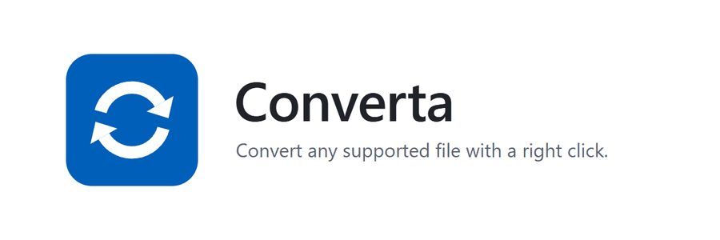
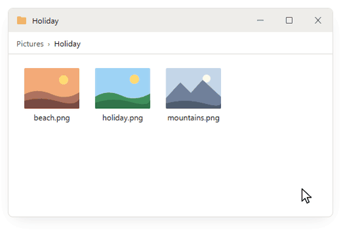

<picture>
  <source media="(prefers-color-scheme: dark)" srcset="assets/banner-dark.gif">
  
</picture>

**[converta.erenk.de](https://converta.erenk.de)** · [Download](https://github.com/Erennkrb/Converta/releases) · [Setup](#setup) · [Help](#help)

You save a photo from the internet and it turns out to be a WEBP file. Your editing software won't open it, the upload form you need it for won't accept it, and suddenly you're looking for an online converter that wants your email address before it gives your own picture back.

Or you just right click the file, choose Converta, then Convert to PNG. The PNG appears right next to the original and you get on with your day.

That's Converta. It adds file conversion to the right click menu on Windows and Linux. It's free, it's open source, and your files never leave your computer.

<picture>
  <source media="(prefers-color-scheme: dark)" srcset="assets/demo-dark.gif">
  
</picture>

*An animation of how it works. The menu on your system will match your system's own style.*

## What it converts

**Images:** PNG, JPG, WEBP, AVIF, BMP, GIF, TIFF and ICO into each other, and into PDF. GIFs can also become MP4 or WEBM.

**Audio:** MP3, WAV, FLAC, OGG, M4A, AAC, OPUS, WMA and AIFF. All of them can become MP3, WAV, FLAC, OGG, M4A, OPUS, AAC or WMA.

**Video:** MP4, MKV, WEBM, MOV, AVI, WMV, FLV, M4V, MPG and 3GP into MP4, MKV, WEBM, MOV, AVI or GIF. You can also pull out just the audio, or save a single frame as a picture.

**PDF:** to Word or plain text, or every page as a PNG or JPG.

**Office files:** Word into PDF, DOCX, ODT, RTF or TXT. Excel into PDF, XLSX, ODS or CSV. PowerPoint into PDF, PPTX or ODP.

**3D printing:** STL, OBJ, 3MF, PLY, OFF, GLB and GLTF into STL, OBJ, 3MF, PLY, GLB or OFF. Yes, a file converter that handles your STL files. You're welcome.

**CAD:** STEP and IGES into STL, 3MF, OBJ, PLY or GLB, in millimetres, so your slicer doesn't hand you a part the size of a grain of rice.

**DXF drawings:** into PDF, SVG or PNG.

Your original file is never overwritten. Select several files and they all get converted in one go. And when you turn an animated GIF or a video into a still image, a small window lets you pick the exact frame, because the first frame is never the good one.

## Setup

Downloads are on the [website](https://converta.erenk.de) and the [releases page](https://github.com/Erennkrb/Converta/releases).

### Windows 10 and 11

1. Download `Converta-Setup` and run it.
2. Windows will warn you about an unknown publisher because the installer isn't code signed yet. Click More info, then Run anyway.
3. Click through the setup. The right click menu is set up for you.
4. Right click a file and choose Converta. On Windows 11, hold Shift while you right click, or choose Show more options first.

### Linux

Fully tested on Arch and Fedora. Other distributions will probably work, and if yours does or doesn't, I'd like to hear about it. Alpine and NixOS aren't supported.

**AppImage (easiest):** make the file executable and double click it. This sets up the menu without root. Keep the file where it is afterwards.

**deb or rpm:** install the package, then log out and back in, or run:

```bash
converta --install
```

**tar.gz:** unpack it and run:

```bash
./install.sh
```

Then restart your file manager, right click a file and choose Converta.

### What else you might need

**Audio and video** use FFmpeg. On Windows it downloads once, the first time you need it. On Linux, install the `ffmpeg` package.

**Word, Excel and PowerPoint** need LibreOffice, or Microsoft Office on Windows. PDF to Word works without either.

**GNOME Files** needs `nautilus-python` for the Converta submenu (on Debian and Ubuntu it's called `python3-nautilus`).

## Help

**I can't find Converta in the menu.** On Windows 11, hold Shift while you right click. On Linux, restart your file manager. On GNOME without `nautilus-python`, Converta is under Scripts. In any other file manager, use Open with. Converta only appears on file types it supports.

**Windows says the installer is from an unknown publisher.** That's because it isn't code signed yet. Click More info, then Run anyway. The full source code is in this repository if you'd like to check it first.

**Audio or video conversion fails on Linux.** Install the `ffmpeg` package. On Fedora, the default `ffmpeg-free` package leaves out some codecs, so converting to MP4 or MOV may need the full FFmpeg.

**How do I uninstall it?** On Windows, go to Settings, Apps, Installed apps, Converta. On Linux, run `converta --uninstall` first, or start the AppImage with `--uninstall`, then remove the package or file.

**Something else is broken, or a format is missing?** [Open an issue](https://github.com/Erennkrb/Converta/issues). Please say what you tried, which file type it was and which system you're on.

## Building from source

On Windows:

```powershell
winget install Python.Python.3.13 JRSoftware.InnoSetup
python -m pip install -r requirements.txt
python main.py --install
powershell -ExecutionPolicy Bypass -File .\build.ps1
```

On Linux:

```bash
python3 -m venv .venv
.venv/bin/pip install -r requirements.txt
.venv/bin/python main.py --install
```

## License

[AGPL 3.0](LICENSE), because Converta uses PyMuPDF, which requires it.
